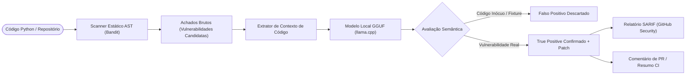

# Auditor de Segurança Estática Aumentado (SAST A.I.)

<div align="center">


<p>Ferramenta de linha de comando e <b>GitHub Action</b> para análise estática de segurança em pipelines de CI/CD, utilizando modelos locais <b>GGUF (CodeLlama/Mistral)</b> para validação semântica de contexto e eliminação automática de falsos positivos.</p>

</div>

---

## 🏗️ Fluxo de Análise e Triagem por IA



---

## 🏛️ Clean Architecture: Estrutura em Camadas

### 1. Ordem de Escrita (de dentro pra fora)

| Ordem | Camada | Arquivo(s) | Por quê essa ordem |
|---|---|---|---|
| 1 | Domínio / Enums & Modelos | `app/core/domain/enum/severity.py`<br/>`app/core/domain/models/vulnerability.py` | Modela vulnerabilidades, relatórios de auditoria e avaliações de falso positivo sem dependência externa. |
| 2 | Domínio / Portas & Interfaces | `app/core/domain/gateway/sast_scanner_gateway.py`<br/>`app/core/domain/gateway/llm_auditor_gateway.py`<br/>`app/core/domain/gateway/report_formatter_gateway.py` | Contratos abstratos para escaneamento AST, auditoria por IA e serialização SARIF. |
| 3 | Aplicação / Casos de Uso | `app/core/usecase/run_security_audit_usecase.py`<br/>`app/core/usecase/generate_sarif_report_usecase.py` | Orquestra a execução da análise, filtragem de falsos positivos e geração de métricas de risco. |
| 4 | Infraestrutura / Adaptadores | `app/infrastructure/gateway/bandit_scanner_impl.py`<br/>`app/infrastructure/gateway/gguf_llm_auditor_impl.py`<br/>`app/infrastructure/gateway/sarif_formatter_impl.py`<br/>`app/infrastructure/config/settings.py` | Implementações técnicas reais integradas ao binário do Bandit, modelos GGUF locais e padrão OASIS SARIF v2.1.0. |
| 5 | Apresentação / CLI | `app/presentation/cli/main.py` | Interface de linha de comando com suporte a argumentos (`--format`, `--output`, `--fail-on`). |

### 2. Ordem de Leitura (de fora pra dentro)

| Ordem | Pergunta que você está respondendo | Arquivo(s) |
|---|---|---|
| 1 | Quais comandos e opções o CLI oferece? | `app/presentation/cli/main.py` |
| 2 | O que o caso de uso manda executar durante o scan? | `app/core/usecase/run_security_audit_usecase.py` |
| 3 | Como as anomalias e achados de segurança são modelados? | `app/core/domain/models/vulnerability.py` |
| 4 | Quais contratos regem o scanner e o modelo GGUF? | `app/core/domain/gateway/*` |
| 5 | Como o Bandit é invocado e o SARIF é gerado? | `app/infrastructure/gateway/*` |

---

## ⚡ Integração com GitHub Actions

Você pode usar esta ferramenta diretamente no seu workflow de CI/CD:

```yaml
name: Security Audit

on: [push, pull_request]

jobs:
  sast:
    runs-on: ubuntu-latest
    steps:
      - uses: actions/checkout@v4
      - name: AI Augmented SAST Scan
        uses: Elyyihz/ai-augmented-sast-auditor@v1
        with:
          path: '.'
          fail-on: 'HIGH'
          output: 'results.sarif'
      - name: Upload SARIF report
        uses: github/codeql-action/upload-sarif@v3
        if: always()
        with:
          sarif_file: 'results.sarif'
```

---

## 💻 Uso via Linha de Comando (CLI)

```bash
# Execução direta escaneando o diretório atual
python -m app.presentation.cli.main .

# Gerar saída no padrão SARIF para ferramentas de segurança
python -m app.presentation.cli.main src/ --format sarif --output audit.sarif

# Gerar resumo em Markdown para Pull Requests
python -m app.presentation.cli.main . --format markdown
```

---

## 🐳 Execução via Docker

```bash
# Executar análise em container isolado
docker compose run --rm sast-auditor /workspace --format table
```

---

## 🧪 Testes Automatizados

```bash
python -m venv .venv
source .venv/bin/activate
pip install -r requirements.txt
pytest tests/ -v
```

---

## 📄 Licença

Distribuído sob a licença MIT. Consulte `LICENSE` para mais detalhes.
